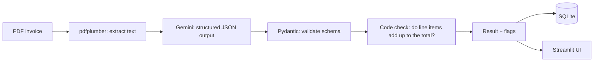

# Invoice Extractor

Upload a PDF invoice and get clean, structured data back: invoice number, date, vendor, customer, currency, line items and totals. The system also checks its own output, so wrong or suspicious results are flagged instead of silently trusted.

**Live demo:** https://invoice-extractor-demo23.streamlit.app
**Video walkthrough:** https://drive.google.com/file/d/1sLcA6luQkw3C3TMnL7sqW2oZ9yb-e0Kv/view?usp=drivesdk

> The demo uses synthetic (generated) invoices. The sample button in the app downloads one you can try.

## Problem

Invoices arrive as PDFs in many layouts. Copying their data by hand is slow and error-prone. A language model can read them, but models can also invent values, misread dates, or follow instructions hidden inside a document. This project extracts the data and adds checks around the model.

## How it works



1. **Text extraction:** `pdfplumber` reads the text of the PDF.
2. **Structured extraction:** Gemini (`gemini-3.1-flash-lite`) returns JSON that must match a Pydantic schema. Temperature is 0.
3. **Validation and retry:** invalid JSON or server errors (such as 503) trigger up to 4 retries with backoff.
4. **Arithmetic check in plain code:** subtotal, discount, VAT and total are recomputed. A mismatch adds the `total_mismatch` flag. The model is never trusted to do this check itself.
5. **Storage:** valid invoices go into SQLite (`invoices` and `line_items` tables). Documents that are not invoices are not saved.

### Safety behaviours

| Situation | What the system does |
|---|---|
| Missing field | Returns `null`, never a guess |
| Ambiguous date such as `03/04/2026` | Date is `null` and flag `ambiguous_date` is added |
| Printed total does not match the items | Flag `total_mismatch` (added by code) |
| Document is not an invoice | All fields `null`, flag `not_invoice`, nothing is saved |
| Text inside the PDF tries to instruct the AI | Invoice text is treated as untrusted data; the instruction is ignored and flag `prompt_injection` is added |

## Results

There are no real invoices in this project, so I generated 25 synthetic PDFs with `gen_invoices.py`. The expected answers were written at generation time, before any model run. The set is split in two:

| Set | Cases | Passed | Notes |
|---|---|---|---|
| Dev set | 15 | 15 | Used while building and fixing |
| Hidden set | 10 | 10 | Run **once**, after all development was finished |
| Unit tests | 6 | 6 | `pytest`, no API calls needed |

The cases cover easy invoices, hard layouts, wrong totals, missing fields and prompt-injection attacks.

During development the dev set first scored 14/15 because of a temporary Gemini 503 error. Adding the retry loop fixed it. The hidden set was not used for tuning.

## Limitations (please read)

These numbers are real but should not be read as production accuracy.

- **Synthetic data only.** The test invoices come from the same generator as the development cases, so they are cleaner and more uniform than real-world invoices.
- **Small test set.** 10 hidden cases can show a pipeline works, but cannot prove a reliable accuracy rate.
- **Text PDFs only.** Scanned or photographed invoices need OCR, which is not implemented.
- **Not tested on** Bangla-language invoices, handwriting, multi-page invoices with complex tables, or invoices from real companies.
- **Privacy.** The extracted text is sent to the Gemini API. Do not upload sensitive documents to the public demo.
- **Demo limits.** Files up to 2 MB, and up to 5 different files per browser session. The free Gemini tier can be slow or rate-limited.
- **Currency.** `Tk` is read as BDT, and BDT is the default when no currency is printed.

## Run it yourself

Requires Python 3.12 and a free Gemini API key from https://aistudio.google.com/apikey.

```bash
git clone https://github.com/ztsprofessionalaiid7-alt/invoice-extractor.git
cd invoice-extractor
python -m venv .venv
.venv\Scripts\activate        # Windows (Linux/macOS: source .venv/bin/activate)
pip install -r requirements.txt
```

Create a file named `.env` in the project folder:

```
GEMINI_API_KEY=your_key_here
```

Then:

```bash
streamlit run app.py            # web app
python extract_invoice.py dev/inv_01.pdf   # extract one file to JSON
pytest -q                       # unit tests
python eval_dev.py              # evaluate on the dev set (uses API calls)
```

To also see the "save to database" button and the saved-invoices table locally, add `SHOW_SAVED=1` to `.env`. It is off in the public demo.

`eval_hidden.py` is included for transparency. It was run once for the results above; running it again and tuning against it would make the hidden set meaningless.

## Project files

| File | Purpose |
|---|---|
| `app.py` | Streamlit web app |
| `extract_invoice.py` | Text extraction, Gemini call, schema, retries |
| `pipeline.py` | Total check, SQLite storage |
| `test_pipeline.py` | Unit tests |
| `gen_invoices.py` | Generates the synthetic invoices and expected answers |
| `eval_dev.py`, `eval_hidden.py` | Evaluation scripts |
| `dev/`, `hidden/` | Synthetic test PDFs |
| `dev_cases.jsonl`, `hidden_cases.jsonl` | Expected answers |
| `results_dev.json`, `results_hidden.json` | Saved evaluation outputs |

## Tech stack

Python, pdfplumber, Google Gemini API (`google-genai`), Pydantic, SQLite, Streamlit, pytest.
